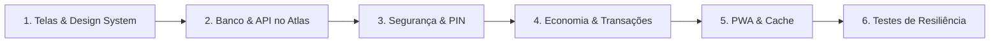

# Plano de Desenvolvimento do MVP - Super Missões Gustavitti (Gustavix)

## 1. Visão Geral do Projeto

O **Super Missões Gustavitti** (Gustavix) é um Web App Progressivo (PWA) de rotina gamificada, planejado para um menino de **8 anos** que estuda no período da **tarde**. A experiência é focada em tela de smartphone (Mobile-First), com tema espacial limpo e moderno (sem infantilização excessiva), hospedado no **Render** (arquitetura stateless) e persistido no **MongoDB Atlas**.

---

## 2. Princípios de Arquitetura e Persistência no Render

1. **Arquitetura 100% Stateless no Render:**
   - O Render descarta dados na memória RAM e arquivos locais após reinicializações.
   - Todo saldo, transação, missão, recompensa e configuração de usuário residem no **MongoDB Atlas**.
2. **Seed Idempotente:**
   - O script de inicialização do banco apenas cria missões e recompensas padrão caso a coleção esteja vazia. Nunca apaga ou sobrescreve o progresso real de Gustavitti a cada reinício do servidor.
3. **Micro-Ledger Financeiro de Moedas:**
   - O saldo não depende de uma variável solta. Cada alteração é um registro auditável (`credito`, `resgate`, `estorno`, `ajuste`).
   - Operações com controle de concorrência e idempotência para evitar duplicidade de moedas ao tocar repetidamente.
4. **PWA Faseado com Foco em Confiabilidade:**
   - **Fase 1 (MVP):** Instalação na tela inicial (modo *standalone*), cache de assets estáticos via Service Worker para carregamento ultrarrápido.
   - Operações financeiras e aprovações exigem conexão com o servidor. O celular não emite moedas de forma autônoma offline.
5. **Segurança Real na Central de Comando:**
   - PIN dos pais com hash (`bcrypt`/`argon2`), limite de tentativas (rate-limiting), sessão com expiração e proteção estrita em todas as rotas administrativas no backend.

---

## 3. Economia de Moedas Calibrada (Ponto de Partida Editável)

A economia foi rebalanceada para incentivar a constância sem inflação rápida:

| Categoria | Faixa de Moedas | Exemplos |
| :--- | :--- | :--- |
| **Missões Comuns de Rotina** | **1 a 3 moedas** | Higiene bucal, arrumar a cama, mochila da escola pronta, leitura básica de 15 min. |
| **Missões Especiais / Metas** | **5 a 8 moedas** | Dever de casa completo da semana, organização geral do quarto, projeto conjunto. |
| **Recompensas da Loja** | **40 a 1.000 moedas** | 40-80 (pequenos privilégios/brincadeiras), 150-300 (noite de jogos/filme), 500-1000 (grandes conquistas). |

*Parâmetros totalmente configuráveis pelos pais na Central de Comando.*

---

## 4. Diário de Bordo Emocional (Check-in Opcional)

Para evitar sobrecarga no MVP, o registro emocional será:
- **Simples, rápido e voluntário** (sem pontuação ou cobrança).
- Tags intuitivas: 🚀 *Empolgado*, 🛡️ *Tranquilo*, 🔋 *Cansado*, ⚡ *Bravo/Frustrado*, 🌪️ *Ansioso*.
- Registro salvo no Atlas para visualização da família em momentos de apoio e diálogo.

---

## 5. Ordem de Desenvolvimento (Passo a Passo)

### Etapa 1: Estrutura do Projeto e Identidade Visual Mobile-First
- [ ] 1.1. Inicializar estrutura de pastas com separação de responsabilidades (`src/models`, `routes`, `controllers`, `services`, `middleware`, `public`).
- [ ] 1.2. Criar Design System moderno e limpo (`design-system.css`): paleta espacial controlada (fundo escuro `#0B0E17`, acentos funcionais em Ciano, Dourado e Roxo), sem excesso de brilhos.
- [ ] 1.3. Desenvolver layout mobile-first para o **Painel do Astronauta** (visão da criança) e **Central de Comando** (visão dos pais).

### Etapa 2: Banco de Dados (MongoDB Atlas) & Conexão Stateless
- [ ] 2.1. Configurar variáveis de ambiente (`.env.example` para controle de versão; `.env` local no `.gitignore`).
- [ ] 2.2. Criar conexão robusta com o **MongoDB Atlas** via Mongoose, com tratamento de reconexão e mensagens de erro transparentes.
- [ ] 2.3. Modelar Schemas: `User`, `Mission`, `MissionLog`, `Reward`, `RewardRedemption`, `Transaction`, `EmotionalLog`.
- [ ] 2.4. Implementar rotina de **Seed Idempotente** (popula itens padrão apenas se o banco estiver vazio, protegendo os dados após reinicializações no Render).

### Etapa 3: Segurança da Central de Comando
- [ ] 3.1. Implementar autenticação por PIN do responsável com hash seguro (`bcrypt`).
- [ ] 3.2. Configurar middleware de autorização para todas as rotas administrativas (`/api/admin/*`).
- [ ] 3.3. Adicionar rate-limiting contra tentativas excessivas e bloqueio de força bruta.
- [ ] 3.4. Gestão de sessão segura (cookies `httpOnly`/`sameSite` ou tokens com expiração).

### Etapa 4: Motor de Economia e Transações Imutáveis
- [ ] 4.1. Criar `TransactionService` para calcular saldo real com base no histórico de créditos e débitos.
- [ ] 4.2. Implementar fluxo atômico de aprovação de missões (garantir que um toque duplo não gere moedas repetidas).
- [ ] 4.3. Implementar solicitação e resgate de recompensas com verificação prévia de saldo e estorno automático se a recompensa for cancelada.
- [ ] 4.4. Proibir saldo negativo e bloqueio de exclusão punitiva de moedas.

### Etapa 5: PWA e Experiência no Smartphone
- [ ] 5.1. Criar `manifest.json` com nome, cores de tema, orientação e ícones espaciais para modo `standalone`.
- [ ] 5.2. Criar `sw.js` com estratégia de cache para arquivos estáticos essenciais (HTML, CSS, JS, ícones).
- [ ] 5.3. Garantir que falhas de rede durante operações financeiras mostrem avisos claros de reconexão.

### Etapa 6: Testes de Integridade, Simulação no Render e Validação
- [ ] 6.1. Simular reinicialização do servidor e verificar se missões, saldo e transações permanecem 100% intactos no MongoDB Atlas.
- [ ] 6.2. Testar instalação PWA no celular e layout em diferentes resoluções.
- [ ] 6.3. Validar fluxo de aprovação e tentativas com senha incorreta.
- [ ] 6.4. Preparar repositório para deploy automático no **Render (onrender.com)**.
