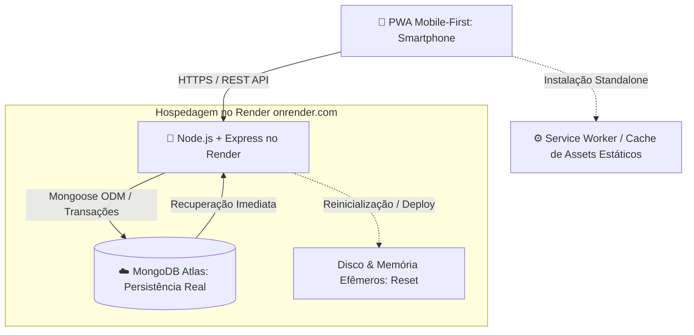

# Arquitetura e Stack Tecnológica Moderna - Gustavix

Este documento detalha o ecossistema tecnológico, as ferramentas, padrões de design visual e a infraestrutura do **Super Missões Gustavitti** (Gustavix).

---

## 1. Visão Geral da Stack & Infraestrutura Stateless



### O Desafio do Render e a Solução Stateless
O **Render** opera com containers e discos temporários: sempre que o serviço hiberna, reinicia ou faz novo deploy, **qualquer dado em memória RAM ou arquivo local é apagado**.

| Onde o dado fica | Comportamento após reiniciar o Render | Estratégia no Gustavix |
| :--- | :--- | :--- |
| **Variável em memória (`let saldo`)** | ❌ **Perdido imediatamente** | **Proibido**. Nunca manter estado crítico em variáveis. |
| **Arquivo local (`data.json`)** | ❌ **Apagado no reinício** | **Proibido**. Não usar escrita de arquivos locais para dados. |
| **`localStorage` do celular** | ⚠️ Persiste no browser, mas não sincroniza | Usado apenas para preferências de visualização (ex: tema). |
| **MongoDB Atlas (Nuvem)** | ✅ **100% Seguro e Permanente** | **Obrigatório**. Saldo, missões, transações e histórico. |

---

## 2. Tecnologias Selecionadas

### 2.1. Banco de Dados: **MongoDB Atlas** + Mongoose
- **Camada gratuita e escalável:** Armazenamento isolado do servidor.
- **Transações Atômicas e Idempotência:**
  - Validação rigorosa para que uma aprovação gere crédito exatamente uma vez.
  - Bloqueio de saldo para impedir múltiplos resgates simultâneos.
- **Rotina de Seed Segura:** Script de inicialização que popula dados padrão (missões iniciais, recompensas) **somente se as coleções estiverem vazias**. Nunca sobrescreve ou apaga dados existentes do Gustavitti ao reiniciar.

### 2.2. Backend: **Node.js + Express**
- **Arquitetura modular em camadas:** Separação explícita entre rotas, validadores, middlewares, controllers e services.
- **Segurança da Central de Comando (Pais):**
  - Hash de PIN com `bcrypt` ou `argon2`.
  - Rate limiting e atraso progressivo para bloquear ataques de força bruta.
  - Sessão protegida via cookies seguros (`httpOnly`, `sameSite`, `secure`) ou tokens com tempo de expiração.
  - Middleware de autenticação obrigatório em todas as rotas administrativas (`/api/admin/*`). Esconder botões na interface não basta.
- **Tratamento de Indisponibilidade:** Se a conexão com o MongoDB Atlas cair, o backend retorna status de erro adequado e o frontend notifica o usuário, sem fingir persistência.

### 2.3. Frontend: **CSS Moderno & JavaScript Sem Framework Pesado**
- **Mobile-First Realista:** Interface desenhada primeiro para a tela vertical do celular.
- **Design System Visual Controlado (Sem Sobrecarga):**
  - **Fundo Limpo:** `#0B0E17` (Void Black) com excelente contraste e legibilidade.
  - **Cores Funcionais:**
    - Ciano (`#00F0FF`): Ações de envio, status de bordo e botões principais.
    - Dourado (`#FFD043`): Moedas estelares e catálogo da loja.
    - Roxo (`#8A2BE2`): Níveis e conquistas.
  - **Efeitos Especiais com Parcimônia:** Glassmorphism e gradientes pontuais (apenas em badges e cabeçalhos de destaque), evitando poluição visual em todos os cartões.
  - **Acessibilidade:** Animações curtas e suporte a `prefers-reduced-motion`.

### 2.4. Estratégia de PWA (Progressive Web App)
- **Fase 1 (MVP Funcional):**
  - Arquivo `manifest.json` com ícone espacial em alta resolução e modo `standalone` (sem barras do navegador).
  - `Service Worker` para carregamento instantâneo via cache dos arquivos estáticos (HTML, CSS, JS, ícones).
  - **Regra de Ouro:** Ações críticas (concessão de moedas, validação de PIN e resgate) requerem conexão com o servidor. O app não valida operações financeiras de forma autônoma offline.
- **Fase Futura:** Consulta offline de missões diárias já baixadas e fila de sincronização quando a rede retornar.

---

## 3. Economia de Moedas: Sistema de Micro-Ledger Financeiro

Para manter a consistência e dar valor real às conquistas de Gustavitti (8 anos), o sistema não apenas atualiza um campo numérico solto, mas registra cada movimentação em uma coleção `transactions`:

| Tipo de Evento | Exemplo | Efeito no Saldo |
| :--- | :--- | :--- |
| **`credito`** | Missão aprovada: "Lição de casa" | `+3 moedas` |
| **`resgate`** | Recompensa aprovada: "Escolher o filme" | `-80 moedas` |
| **`estorno`** | Cancelamento de solicitação recusada | `+80 moedas` (restituição) |
| **`ajuste`** | Correção autorizada pelo responsável | `±X moedas` (com justificativa) |

### Parâmetros Calibrados (Totalmente Editáveis pelos Pais):
- **Missões Comuns:** 1 a 3 moedas.
- **Missões Especiais / Semanais:** 5 a 8 moedas.
- **Recompensas:** 40 a 1.000 moedas (ajustável conforme o ritmo real de Gustavitti).

---

## 4. Estrutura Completa de Pastas

```text
Gustavix/
├── docs/
│   ├── plano_desenvolvimento_mvp.md   # Roadmap em 6 etapas e regras de negócio
│   └── stack_tecnologica.md           # Especificação arquitetural (este documento)
├── src/
│   ├── config/                        # Conexão MongoDB Atlas e variáveis de ambiente
│   ├── models/                        # Schemas Mongoose (User, Mission, MissionLog, Reward, Transaction, EmotionalLog)
│   ├── routes/                        # Definição das rotas públicas e administrativas
│   ├── controllers/                   # Orquestração de requisições e respostas
│   ├── services/                      # Regras de negócio, cálculo de moedas e auditoria
│   ├── middleware/                    # Autenticação do responsável, rate limit e segurança
│   ├── validators/                    # Validação de schemas e entradas da API
│   └── public/                        # Frontend PWA Mobile-First
│       ├── manifest.json              # Manifesto PWA (standalone, ícones, tema)
│       ├── sw.js                      # Service Worker para cache de estáticos
│       ├── index.html                 # Ponto de entrada do app
│       ├── css/
│       │   ├── design-system.css      # Variáveis, tokens e reset
│       │   ├── layout.css             # Grid mobile, cards e painéis
│       │   └── components.css         # Botões, modais, status e moedas
│       ├── js/
│       │   ├── app.js                 # Inicialização da interface e rotas da tela
│       │   └── api.js                 # Cliente HTTP seguro com tratamento de erros
│       └── assets/                    # Ícones de astronauta, planetas e moedas
├── tests/                             # Testes automatizados (idempotência e saldo)
├── server.js                          # Ponto de partida do servidor Express
├── package.json                       # Dependências e scripts de execução
├── .env.example                       # Modelo de variáveis de ambiente seguras
├── .gitignore                         # Bloqueio de .env, node_modules e logs
├── AGENTS.md                          # Regras e contexto do projeto
└── manual_super_missoes_gustavitti.md # Manual de referência conceitual
```
